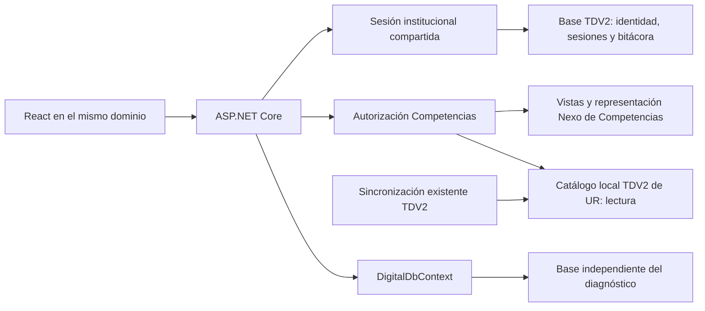

# Competencias digitales UACJ

**Sesión y textos — 2026-10-30:** Competencias y Procedimientos comparten un máximo de dos horas desde el login original; no se amplía con actividad, autoguardado, cambio de sitio o representación. Vencimiento limpia la vista y vuelve al portal `/`, sin guardar ni iniciar otro OAuth. Cookies anteriores sin inicio original requieren un acceso explícito nuevo. Avance conserva su fórmula y muestra «Porcentaje de avance»; se retiran sólo las leyendas solicitadas de ambos reportes. [Política efectiva, compatibilidad, archivos y pruebas](../migracion/SESIONES_DOS_HORAS_Y_REPORTES_20261030.md).

**Definición vigente — población por canónico:** usuarios únicos `usuario_id` con acceso vigente a Competencias; empleado sólo para correspondencias. Compartir empleado no reduce el total ni bloquea por sí mismo los estados de encuestas no afectadas. [Reglas de atribución, porcentaje, pruebas y diagnóstico](POBLACION_CANONICA_Y_ESTADOS_20261030.md). Sustituye las reglas anteriores de bloqueo global por empleado compartido.

**Tres grupos de empleado en conflicto — 2026-10-30:** se confirmó mediante la salida del operador que `employee_conflict=3` bloquea certificar la población de 80 candidatos. Los conteos registrados se muestran por UR guardada y se distinguen de los indicadores certificados. Usar `Diagnose-DigitalPopulation.ps1 -PrivateEmployeeConflicts` para revisar los registros fuera de Git; no compartir el archivo privado. [Definición exacta, fuentes, pruebas y pasos del operador](CONFLICTOS_EMPLEADO_Y_CONTEOS_20261030.md).

**Avance no disponible — 2026-10-30:** usar el [diagnóstico dirigido por fases](DIAGNOSTICO_POBLACION_20261030.md). Identifica incidencias de correspondencia, permisos/contrato y esquema, sin sustituir población por encuestas existentes. La herramienta anterior omitía el estado activo al construir el catálogo; corregido. El caso institucional no se declara resuelto: requiere la salida de `scripts/Diagnose-DigitalPopulation.ps1` en el PowerShell habitual del operador. Sin migraciones ni operaciones administrativas en esta revisión.

**Indicadores y reapertura individual — 2026-10-29:** la población vigente depende del acceso a la aplicación, sin exigir el módulo Encuesta. Configuración conserva el padre y usa los hijos `gestion_encuestas` y `actuar_como_usuario`. La reapertura individual autorizada conserva la captura y archiva el definitivo; sustituye la prohibición histórica de reapertura descrita más abajo. Requiere nueva migración Digital, pendiente de aplicación institucional. [Contrato, concurrencia, permisos, pruebas y límite de lectura real](INDICADORES_SUBMODULOS_REAPERTURA_20261029.md).

**Presentación de la encuesta — 2026-10-29:** instrucciones concentradas al inicio de cada apartado; controles «Inicial» y «No aplica» sin textos añadidos. «Marcar pendientes como Inicial» conserva sus protecciones y se deshabilita al quedar sin vacíos, sin cantidades ni leyendas por categoría. No cambia la captura, evaluación o población. [Archivos, comprobaciones y capturas](PRESENTACION_ENCUESTA_20261029.md).

**Población e instrucciones — 2026-10-29:** la participación actual usa personas únicas con acceso vigente a Competencias digitales (definición posterior por aplicación), obtenidas en bloque de la publicación Nexo existente. Sustituye las metas manuales, conservadas como histórico de consulta, y distingue población sin iniciar de filas vacías creadas por privacidad. Resultados generales mantiene sus contextos históricos. Los selectores excluyen nivel 1/tipo N, sin suprimir relaciones. Instrucciones exactas, Inicial limitado a pendientes de categoría y once equivalencias comprobadas sin cambio metodológico. [Definiciones, contrato, pruebas, color y evidencia](POBLACION_INSTRUCCIONES_20261029.md). Las reglas anteriores de metas manuales en esta guía se conservan como documentación histórica y ya no describen el avance actual.

**Revisión de persistencia de identidad — 2026-10-29:** la lectura de alias reutiliza el perfil Microsoft y la identidad local existentes. La propuesta de tabla en TDV2 conserva específicamente el ID canónico Nexo, que el modelo anterior no almacena de forma duradera; no crea otro participante ni modifica el diagnóstico. Se mantiene pendiente y sin aplicar. Acceso independiente de ambos sitios comprobado con fuentes sintéticas, sin conexiones ni migraciones durante esta revisión. [Modelo actual, necesidad, alternativas y cambio exacto](../migracion/REVISION_VINCULO_IDENTIDAD_20261029.md).

**Identidad Microsoft y alias — 2026-10-29:** la identidad canónica se resuelve por vínculo estable o coincidencia única UPN/SMTP verificada antes de consultar los permisos del subsitio. Un alias no cambia empleado, captura ni informes, y no permite elegir otra cuenta autorizada. Nueva tabla/migración exclusivamente en **Tdv2DbContext**, con SELECT/INSERT del rol web; no hay migración Digital ni cambios en la cola Nexo. [Archivos, requisitos, verificación y límites institucionales](../migracion/IDENTIDAD_MICROSOFT_ALIAS_20261029.md).

**Costo auditado — 2026-10-29:** [desglose por base/contexto, percentiles con 1/10/25 personas, comparación y evidencia](COSTO_AUTOGUARDADO_20261029.md). Las 35 sentencias corresponden al PUT, no al login ni a los fixtures; se distinguen comandos transaccionales, trabajo interno de triggers y mantenimiento del pool. Se conserva el comportamiento de captura siguiente. Los observadores viven exclusivamente en NativeVerification/navegador de pruebas, sin diagnóstico en la interfaz ni configuración nueva de producción.

**Autoguardado vigente — 2026-10-29:** después de un fallo se detienen los envíos automáticos, incluso al editar o recuperar conexión/foco. No hay cola/replay de respuestas. Guardar avance consulta el estado confirmado y guarda los datos actuales sin adoptar versiones ajenas; solo su confirmación reactiva el autoguardado. La recarga recupera únicamente lo persistido. Comparación semántica evita solicitudes sin cambios; auditoría local/manual y reintentos de entrega Nexo intactos. [Archivos, medición PostgreSQL aislada, pruebas y evidencia](AUTOGUARDADO_POSTGRES_Y_RECUPERACION_20261029.md). Sustituye la recuperación automática descrita en la entrada de captura fluida siguiente; no requiere migración ni configuración nueva.

**Mi espacio vigente — 2026-10-28:** una cuenta con acceso exclusivo a Competencias entra directamente desde Mi espacio o una entrada genérica. Con varios sitios comprobados se ofrece **Elige un sitio**; con ninguno se mantiene la identidad y con errores no se infiere ausencia de permisos. No cambia la navegación, representación, captura ni actividad manual de Competencias. [Registro extensible, retorno y pruebas](../migracion/MI_ESPACIO_SITIOS_20261028.md).

**Acceso y mensajes vigentes — 2026-10-28:** la entrada genérica `/connect` conduce al selector `/accesos`; los enlaces de cada aplicación conservan su propio destino. La identidad Microsoft se mantiene aunque una aplicación deniegue acceso; cada backend sigue comprobando sus permisos. «Acceso no disponible» muestra el nombre de la aplicación, portal, cambio de cuenta y sólo alternativas verificadas. Se retira la explicación larga de guardado y permanece el indicador breve estable; no cambian consentimiento, captura, auditoría ni informe. [Archivos, pruebas, capturas y límites](../migracion/ACCESO_POR_APLICACION_Y_MENSAJES_20261028.md).

**Autoguardado vigente — 2026-10-28:** se puede seguir respondiendo mientras se guarda. Se agrupan cambios durante 1500 ms y se serializan las solicitudes, conservando la última edición, la versión del servidor y el reintento exacto tras pérdida de respuesta. Indicador estable; «Guardar avance» espera toda la captura y confirma un único evento manual. La navegación/finalización siguen esperando validación del backend. [Mediciones, archivos, pruebas y límites](AUTOGUARDADO_FLUIDO_20261028.md). Esta revisión sustituye únicamente el bloqueo de controles durante autoguardados descrito anteriormente.

**Actividad de guardado vigente — 2026-10-28:** autoguardado de perfil/respuestas y guardados por navegación no generan eventos de guardado para Nexo; conservan la bitácora TDV2. Solo «Guardar avance» confirma actividad manual mediante UUID después de persistir, sin alterar revisiones para auditar. Doble clic/reintento deduplicado; fallos centrales conservan cola y captura. Los demás eventos, representación y permisos siguen intactos. [Contrato, archivos, pruebas y límites](GUARDADO_MANUAL_ACTIVIDAD_20261028.md). No requiere migración, configuración ni permisos nuevos.

**Cabecera vigente — 2026-10-28:** fondo azul `#213455` en ambas filas, logo oficial `/images/logos/transformacion-digital-blanco.svg`, nombre y navegación blancos, indicador activo amarillo y foco visible. Se conserva la distribución actual, incluido el pie compartido de seis firmas; no se reorganiza en una sola fila. Esta revisión sustituye solo la barra blanca de la entrega siguiente. Sin cambios de permisos, instrumento, captura, auditoría, paquetes o 401. [Recursos, verificaciones y capturas](../migracion/CABECERA_AZUL_COMPETENCIAS_20261028.md).

**Cabecera y pie vigentes — 2026-10-28:** Competencias adopta la barra blanca del portal con el logotipo oficial oscuro de Transformación Digital. Se conservan cuenta/foto, representación, Noto Sans, ancho adaptable y menú recibido de Nexo. El pie pasa a ser el mismo institucional del portal: UACJ, DGTI, Desarrollo de Sistemas, Tecnología Educativa, Operación y Redes e Inteligencia de Datos. Esta distribución sustituye la indicación anterior de UACJ en cabecera y cinco firmas en pie. Aviso en cuenta y toda la lógica de encuesta/informe/actividad intactos. [Archivos, capturas, verificaciones y límites](../migracion/CABECERA_PIE_JUEGO_20261028.md).

**Instrumento y actividad vigentes — 2026-10-28:** nueva edición `uacj-digital-2026-10-28.1` con once perfiles laborales, funciones Académica/Administrativa/Directiva/Otra y retiro de cuatro herramientas de Microsoft 365 (80 restantes). Borradores: actualización explícita, respuestas vigentes conservadas y archivo anterior dentro de la misma encuesta; no se reclasifican perfiles retirados automáticamente. Definitivas congeladas y privacidad `.2` intactas. Auditoría genérica entregada al contrato publicado de Nexo mediante cola/recibos: el registro local no equivale a recepción central. Nueva migración `20261028175912_DigitalActivityDelivery` para cola y excepción limitada del trigger de borradores; migraciones previas intactas. [Correspondencias, arquitectura, permisos mínimos, respaldo, comandos Windows/Ubuntu, pruebas y evidencia](INSTRUMENTO_ACTIVIDAD_20261028.md). Esta edición sustituye los catálogos/cantidades anteriores, conservando su lectura histórica. No se modificó la configuración ni se probó contra Nexo institucional.

**Informe, aviso y orden vigentes — 2026-10-27:** «Mi informe y ruta» separa resumen, recomendaciones, fases y detalle; este último tiene pestañas/una tabla en escritorio y selector/fichas en móvil. Sin respuestas reales no muestra puntuaciones ni pendientes masivos. El backend distingue valores iniciales de respuestas explícitas y conserva el informe definitivo almacenado. Aviso de privacidad con cuerpo literal del usuario, URL visible y nueva versión `uacj-digital-aviso-2026-10-27.2`; las aceptaciones anteriores permanecen, captura requiere la vigente y finalizadas no se reabren. Menú sin grupos: se respeta `m.orden` publicado por Nexo, filtrando las mismas autorizaciones. El operador debe colocar Encuesta=1, Mi informe y ruta=2, Avance por dependencia=3, Resultados generales=4, Configuración=5. No se modificó Nexo ni se verificaron sus posiciones reales. [Detalle, archivos, pruebas, capturas y pendientes](../migracion/INFORME_AVISO_MENU_20261027.md). Estas reglas sustituyen las descripciones históricas de aviso/orden siguientes. No hay nuevas migraciones.

**Navegación y textos anteriores — 2026-10-27 (sustituidos por la revisión siguiente):** Avance por dependencia → Resultados generales → Encuesta → Mi informe y ruta → Configuración, mostrando exclusivamente concesiones existentes, sin agrupación personal/reportes ni separadores. Se recupera el orden anterior entregado por el backend; no cambian IDs/permisos ni se requiere administración de Nexo. El aviso conserva «Aviso de privacidad», versión, cuerpo y aceptación; reportes con clave - nombre y filtros/alcances intactos. Se mantienen 1400 px, cuenta adaptable, UACJ en cabecera y DGTI más cuatro subdirecciones en el pie. [Corrección vigente y capturas](../migracion/CORRECCION_MENU_PIE_TDV2_20261027.md); las demás mejoras de la [entrega anterior](../migracion/NAVEGACION_TEST_Y_PIES_20261027.md) permanecen.

**Distribución actualizada — 2026-10-27:** cabecera, navegación, título, contenido y pie comparten un contenedor de hasta 1400 px y márgenes adaptables. UACJ y cuenta permanecen alineados en una fila; en móvil se muestra el botón de fotografía, con nombre completo accesible y disponible en el menú. El pie conserva Dirección General/Sistemas/Tecnología Educativa/Operación y Redes/Inteligencia de Datos, jerarquía y letras uniformes, pasando a varias filas sin comprimir firmas. Colores, fuentes y captura permanecen intactos. [Archivos, siete anchos verificados, capturas y límites](../migracion/DISTRIBUCION_COMPETENCIAS_1400_20261027.md).

**Corrección de regresión visual — 2026-10-27:** el shell React conserva ahora las rutas ASP.NET del CSS institucional y la precarga Noto al pasar por Vite. Se recuperan variables, fondo azul, logotipo/cuenta/navegación, bordes y pie sin modificar CSS, permisos ni encuesta. [Diagnóstico medido, capturas y límites](../migracion/REGRESION_VISUAL_COMPETENCIAS_20261027.md).

**Identidad visual vigente — 2026-10-27:** Noto Sans local y colores institucionales compartidos con portal/Procedimientos; cabecera UACJ con cuenta y fotografía existentes. DGTI pasa al pie, seguida de Desarrollo de Sistemas, Tecnología Educativa, Operación y Redes e Inteligencia de Datos. Prefijos regulares y nombres en negrita, subdirecciones uniformes, pie adaptable en flujo normal. Brechas con #F0BD10, etiqueta e icono. No se modifican captura, evaluación, permisos, representación, reinicio ni migraciones. Pruebas de esta revisión: React real y respuestas sintéticas, sin PostgreSQL ni migraciones/reinicios. [Archivos, fuentes, verificaciones y evidencias](../migracion/IDENTIDAD_VISUAL_20261027.md). Esta revisión sustituye las indicaciones de identidad de las secciones históricas siguientes.

Implementación local del subsitio `/competencias-digitales` en la publicación existente de Transformación Digital. ASP.NET Core 10, EF Core/Npgsql, React, TypeScript y MUI. No se creó otra publicación ni se ejecutaron cambios institucionales. El estado de pruebas de esta entrega se registra en `ESTADO_MIGRACION.md`; la configuración real queda para una fase explícita del operador.

## Organización del perfil y portal público — revisión anterior 2026-10-27

Perfil se organiza en Datos institucionales, Perfil laboral y Uso de herramientas e información; dos columnas adaptables y orden real del documento para lectura, teclado y foco en el primer pendiente. Se conservan controles/IDs, resolución institucional/No aplica, respuestas, autoguardado, validación secuencial y definitivas. El contenedor del subsitio usa altura mínima de ventana y contenido flexible para mantener el pie al fondo, sin fijarlo ni cubrir contenido. Cuenta/foto, representación y aviso de lectura siguen en sus componentes actuales.

El portal tiene Noto Sans local, contacto actualizado, textos de etapas/diagnóstico, tres PDF originales y pie con firma principal UACJ/DGTI antes de las subdirecciones. Competencias conserva solo las cuatro subdirecciones. **Responder encuesta de competencias digitales** enlaza al subsitio; **Juego de Microsoft 365 / Iniciar test** abre el juego integrado, con Inter y lógica originales. Esta separación sustituye las referencias históricas al botón único que enviaba al diagnóstico.

Sin nuevas migraciones ni cambios de esquema/secretos/permisos. **No se ejecutaron reinicios**: la prueba correspondiente se excluyó mediante `TDV2_DIGITAL_PRESENTATION_ONLY=1`. Veinte grupos de navegador con PostgreSQL aislado correctos, además de tipos, frontend, ASP.NET y portal/juego. [Archivos modificados, PDF, fuentes, evidencia visual, comandos, paquete y límites](../migracion/PORTAL_Y_PERFIL_20261027.md). El reinicio administrativo ya implementado y sus requisitos operativos se conservan en la sección siguiente.

## Reinicio administrativo, informe y pie — 2026-10-27

Esta revisión sustituye expresamente la prohibición anterior de reinicio administrativo. La encuesta sigue siendo única e inmutable en el uso normal; **solo un reinicio global confirmado por un administrador real de Competencias permite comenzar otra**. No hay reapertura individual. La migración inicial `20261027070211_InitialDigitalDiagnosis`, informada como aplicada en `competencias_digitales_db`, y su Designer se conservan intactos. No se accedió a esa base ni se ejecutaron acciones institucionales.

### Alcance y confirmación

Configuración incorpora «Reiniciar encuestas». El resumen identifica todas las unidades de Competencias y cuenta encuestas en captura/finalizadas, perfiles con contenido, respuestas por herramienta, informes, confirmaciones y metas. Perfiles, respuestas e informes son partes del registro de encuesta: **no se suman como filas independientes**. La opción «Eliminar también las metas de participación» comienza desmarcada. Cambiarla requiere generar otro resumen.

Preparar el resumen no elimina datos. Crea una operación UUID vinculada al administrador real (correo y número textual de empleado), generación, revisión, opción de metas, conteos, fecha del servidor y caducidad de cinco minutos. Ejecutar exige el ID de esa operación y el texto exacto `REINICIAR ENCUESTAS`, además de sesión, autorización Nexo de esta aplicación/módulo Configuración y CSRF. Otros roles, administradores de otra aplicación y toda representación se rechazan. Cancelar, Escape, abrir Configuración, guardar metas o aplicar migraciones no ejecutan el reinicio.

Si cualquier captura, finalización, confirmación o meta cambia entre resumen y ejecución, incluso conservando el mismo conteo, se devuelve conflicto y se exige revisar otro resumen. Una operación terminada devuelve siempre su recibo al mismo administrador autorizado: un reintento tras doble clic o pérdida de respuesta no borra capturas de la generación siguiente. La opción de metas y los conteos ejecutados proceden del registro del servidor, no del segundo payload del navegador.

### Tablas, identificadores y excepción SQL

| Objeto | Tratamiento |
|---|---|
| `public.cd_surveys` | Vacía todas las filas. Incluye perfil, respuestas, instrumento/contexto del intento, fecha de finalización y `ReportJson`; no existen otras tablas de respuestas/informes |
| `public.cd_consents` | Vacía todas las confirmaciones del diagnóstico, incluidas versiones anteriores |
| `public.cd_targets` | Se conserva por defecto; se vacía solo si el resumen confirmado incluye metas |
| `public.cd_control` | Conserva su fila fija `Id=1`; cambia `Generation` UUID y aumenta `Revision` |
| `public.cd_reset_operations` | Conserva resúmenes/recibos y auditoría, sin perfiles, respuestas ni secretos |
| `public.__CDMigrationsHistory` | Intacto |
| TDV2, Nexo y catálogos | No forman parte de la limpieza. Sesión y auditoría HTTP siguen utilizando sus mecanismos actuales |

Las claves inspeccionadas son UUID de encuestas, empleado/versión en confirmaciones y UR textual en metas. **No hay identidades ni secuencias numéricas autogeneradas en estas tablas; no se reinicia ninguna secuencia.** Los nuevos UUID de generación/operación siguen siendo UUID. `Id=1` del control es una clave fija, configurada `ValueGeneratedNever`; `Revision` es un metadato de invalidación, no una identidad autogenerada ni un contador de participantes. No se renumeran empleados, UR, Nexo, auditorías o migraciones.

Nueva migración exclusiva de DigitalDbContext: **`20261027131404_AdministrativeDigitalReset`**. Agrega las dos tablas de control, triggers de revisión y las funciones `public.cd_prepare_reset(uuid,text,text,boolean)`, `public.cd_execute_reset(uuid,text,text)` y `public.cd_track_revision()`. No elimina datos al aplicarse. El trigger original `cd_survey_immutable` permanece sin modificación: las escrituras/borrados normales de definitivas continúan bloqueados.

La excepción usa `TRUNCATE` únicamente sobre los nombres calificados anteriores, dentro de la transacción de ejecución y sin `CASCADE` ni `RESTART IDENTITY`. El rol web no recibe TRUNCATE ni DELETE de encuestas. Las funciones son `SECURITY DEFINER`, tienen `search_path=pg_catalog,pg_temp` y revocan el EXECUTE público en la misma migración. No reciben SQL, tablas, bases ni nombres de objetos desde el navegador. PostgreSQL hace transaccional el vaciado y toma bloqueos exclusivos; un fallo posterior revierte datos, generación y recibo. [Documentación de TRUNCATE](https://www.postgresql.org/docs/18/sql-truncate.html). El diseño de propietario, ruta de búsqueda y EXECUTE restringido sigue las precauciones de [CREATE FUNCTION](https://www.postgresql.org/docs/18/sql-createfunction.html).

### Generaciones, concurrencia y auditoría

Lecturas compuestas y escrituras del diagnóstico toman el bloqueo transaccional compartido `2710202601`; preparar/ejecutar un reinicio toma el exclusivo. Se conserva además el bloqueo por empleado y la versión optimista. La revisión aumenta mediante triggers de las tres tablas, incluyendo cambios que dejan iguales los conteos. La función también bloquea explícitamente esas tablas antes de comprobar revisión y limpiar. Un guardado ya iniciado termina primero e invalida el resumen; si el reinicio termina primero, la solicitud antigua se rechaza.

Aviso, guardado, finalización y metas ahora requieren `generation`, el UUID entregado por el servidor. Se valida bajo el bloqueo global antes de crear, guardar, finalizar o atender reintentos. Una petición anterior no puede aceptar el aviso de la nueva generación, recrear un intento borrado, finalizarlo ni sobrescribir respuestas/metas nuevas, aunque coincidan versiones numéricas. Los clientes antiguos sin generación también se rechazan. La respuesta posterior a una escritura comprueba que no ocurrió un reinicio entre commit y lectura.

No existen cachés persistentes de resultados del diagnóstico. Los agregados siguen consultándose desde PostgreSQL con alcance autorizado. El frontend comprueba la generación al recuperar foco y cada 30 segundos mientras está visible, y recibe un aviso entre pestañas mediante BroadcastChannel después de un reinicio. Una discrepancia desmonta la captura/informe/indicadores anteriores y pide recargar; errores de escritura por generación invalidan inmediatamente. El diálogo de la operación en curso conserva su ID para reintentar y muestra el recibo antes de actualizar Configuración. No se guarda identidad, captura ni respuestas en almacenamiento local. Un dispositivo desconectado puede seguir mostrando su vista anterior hasta reconectar; sus escrituras se rechazan siempre en el servidor.

La auditoría autoritativa del reinicio vive en `cd_reset_operations`, dentro de la misma transacción que el vaciado: administrador real, empleado, UUID de operación, fechas, alcance global fijo, generación/revisión previas, opción de metas, cantidades y generación posterior. Los registros preparados/cancelados/vencidos se conservan. La cuenta web no puede insertar, actualizar, eliminar ni truncar esa tabla directamente. Las bitácoras existentes de TDV2 se conservan; no se intenta una transacción distribuida para duplicar el recibo. Down rechaza eliminar estos metadatos cuando hay operaciones registradas.

### Permisos y habilitación posterior

No cambian claves de secretos, conexiones, ID de aplicación, módulos o roles de Nexo. Reinicio pertenece al módulo Configuración y al rol `administrador` existentes. No se requiere un nuevo permiso Microsoft, sincronizador o conexión. Antes de publicar esta revisión, el operador debe:

1. Verificar el destino aprobado y respaldar exclusivamente la base del diagnóstico. Programar mantenimiento para impedir clientes de la versión anterior durante la actualización.
2. Usar un propietario de objetos distinto del rol web, preferiblemente NOLOGIN; el ejecutor de migraciones puede asumir ese propietario mediante el mecanismo aprobado. El rol web **no debe ser propietario, superusuario, miembro del propietario ni tener CREATE/DDL, TRUNCATE o capacidad de desactivar triggers**. Si el aprovisionamiento actual usa la misma cuenta como propietaria y ejecutora web, separar esas funciones antes de habilitar el reinicio.
3. Aplicar solo la nueva migración de DigitalDbContext con ese propietario. Las funciones deben pertenecer al propietario protegido de los objetos CD, que puede leer las tres tablas, truncarlas, actualizar control y escribir operaciones. No necesitan privilegios sobre TDV2/Nexo ni otras tablas.
4. Mantener los permisos DML existentes y añadir solo SELECT de control y EXECUTE de las dos funciones administrativas al rol web. No conceder acceso directo a operaciones ni EXECUTE de la función de trigger.
5. Publicar backend/frontend compatibles con `generation`; comprobar permisos y lecturas con cuentas controladas. El reinicio real requiere una autorización operativa separada y la confirmación explícita en Configuración. No finalizar ni borrar diagnósticos reales como prueba incidental.

Comandos **para la fase futura del operador**, con conexiones aprobadas inyectadas al proceso; no se ejecutaron contra infraestructura institucional:

```powershell
# Generar/revisar exclusivamente el incremento desde la migración ya aplicada.
dotnet ef migrations script 20261027070211_InitialDigitalDiagnosis 20261027131404_AdministrativeDigitalReset --context DigitalDbContext --project tdv2 --output "<ruta_segura>/reinicio-diagnostico.sql" -- --environment Production
dotnet ef migrations has-pending-model-changes --context DigitalDbContext --project tdv2 -- --environment Production
# Aplicación explícita. ConnectionStrings__CompetenciasDigitales debe ser la del migrador aprobado.
dotnet ef database update 20261027131404_AdministrativeDigitalReset --context DigitalDbContext --project tdv2 -- --environment Production
```

Plantilla psql de permisos; `rol_web` se suministra con el nombre real aprobado mediante `-v rol_web=...`, nunca se adivina:

```sql
GRANT SELECT ON TABLE public.cd_control TO :"rol_web";
GRANT EXECUTE ON FUNCTION public.cd_prepare_reset(uuid,text,text,boolean) TO :"rol_web";
GRANT EXECUTE ON FUNCTION public.cd_execute_reset(uuid,text,text) TO :"rol_web";
REVOKE ALL ON TABLE public.cd_reset_operations FROM :"rol_web";
REVOKE INSERT, UPDATE, DELETE, TRUNCATE ON TABLE public.cd_control FROM :"rol_web";
REVOKE TRUNCATE ON TABLE public.cd_surveys, public.cd_consents, public.cd_targets FROM :"rol_web";
REVOKE DELETE ON TABLE public.cd_surveys, public.cd_consents FROM :"rol_web";
-- Comprobar propietario, search_path y EXECUTE; también privilegios heredados.
SELECT p.oid::regprocedure, pg_get_userbyid(p.proowner) AS propietario, p.prosecdef, p.proconfig, p.proacl
FROM pg_proc p WHERE p.oid IN (
 'public.cd_prepare_reset(uuid,text,text,boolean)'::regprocedure,
 'public.cd_execute_reset(uuid,text,text)'::regprocedure,
 'public.cd_track_revision()'::regprocedure);
SELECT has_table_privilege(:'rol_web','public.cd_surveys','TRUNCATE') AS debe_ser_false,
       has_table_privilege(:'rol_web','public.cd_reset_operations','UPDATE') AS debe_ser_false;
```

No se entregan nombres definitivos de roles, contraseñas o servidores. Los GRANT/REVOKE anteriores no sustituyen comprobar propiedad y membresías; un propietario mantiene facultades aunque se le revoquen privilegios explícitos. No aplicar migraciones de Tdv2DbContext sobre el diagnóstico.

### Respaldo y recuperación

El reinicio no contiene «deshacer». Antes de usarlo realmente, respaldar la base completa del diagnóstico —incluidos control, operaciones e historial— en un destino institucional protegido fuera del repositorio y comprobar restauración. El respaldo contiene datos personales y respuestas; el recibo de reinicio solo cantidades. No basta exportar agregados ni conservar un informe HTML.

Ejemplos para un servicio PostgreSQL aprobado que suministra TLS/autenticación por los mecanismos seguros del operador, sin contraseñas en argumentos:

```text
pg_dump --dbname="service=<servicio_diagnostico_aprobado>" --format=custom --no-owner --no-acl --file="<ruta_segura>/diagnostico-antes-del-reinicio.dump"
pg_restore --list "<ruta_segura>/diagnostico-antes-del-reinicio.dump"
# Restaurar primero en otra base vacía de recuperación autorizada; nunca sobreescribir la activa a ciegas.
pg_restore --dbname="service=<servicio_recuperacion_aprobado>" --single-transaction --exit-on-error --no-owner --no-acl "<ruta_segura>/diagnostico-antes-del-reinicio.dump"
```

Si se necesita recuperar tras un reinicio, detener escrituras, respaldar también el estado posterior y conservar su auditoría. Restaurar y validar en la base de recuperación: conteos, informes, consentimiento, integridad, migraciones y permisos. Incorporar los recibos posteriores desde el respaldo conservado mediante un procedimiento revisado por el operador, sin perder ni duplicar su historial. **Antes de reabrir acceso, rotar la generación a un UUID nuevo y aumentar revisión**, incluso si se recuperan capturas antiguas, para que ninguna pestaña previa sea válida. Esta operación de recuperación pertenece al operador, nunca al rol web:

```sql
BEGIN;
SELECT pg_catalog.pg_advisory_xact_lock(2710202601::bigint);
UPDATE public.cd_control SET "Generation"=pg_catalog.gen_random_uuid(), "Revision"="Revision"+1 WHERE "Id"=1;
COMMIT;
```

Registrar la recuperación en la bitácora operativa y conservar evidencia de los recibos originales. Restaurar permisos/propiedad con los roles aprobados porque los ejemplos omiten owner/ACL. No usar Down para recuperar respuestas ni como mecanismo de reinicio. No se hicieron respaldos ni restauraciones de datos institucionales en este trabajo.

### Informe, brechas y pie

`PersonalReport.tsx` muestra resumen personal e índice global persistido, cinco tarjetas con nivel/distribución/brechas, leyenda, recomendaciones, tres fases con tarjetas y expansión de propuestas adicionales, y resultado por herramienta separado en cinco tablas. Dos columnas cuando caben; una en móvil. Las tablas tienen únicamente desplazamiento horizontal si hace falta: sin límite de altura ni barra vertical interna. Las reglas son exclusivas de `.cd-report`; Procedimientos conserva sus tablas.

Brechas y conteos usan fondo ámbar suave, texto oscuro, icono y etiqueta. Cumple conserva verde y cada nivel sus colores. No aplica, pendientes y herramientas no utilizadas no se cuentan como requisitos cubiertos ni se presentan como dominio. Se utilizan `ReportJson` e instrumento persistidos para definitivas; no se cambiaron cálculos, recomendaciones, rutas ni metodología. Retirados botón, endpoint y generador HTML personal después de revisar sus referencias. La URL retirada recibe el fallback 501 existente de rutas no implementadas; no produce archivo. Las exportaciones CSV agregadas permanecen.

El pie usa exclusivamente las firmas blancas locales `firma-3/5/7/9.png` sobre `#213455`, conservando dimensiones, proporciones, separación y flujo. El texto institucional y enlace se retiraron del pie. «Aviso de privacidad» aparece en el menú compartido de cuenta **solo dentro de Competencias**, mediante callback opcional; abre lectura sin aceptar, guardar ni cambiar el paso. Encabezado, foto, identidad efectiva, salida de representación y avance obligatorio permanecen.

### Archivos y verificación de esta revisión

- Servidor: `DigitalDbContext.cs`, `DigitalResetService.cs`, `DigitalSurveyService.cs`, `DigitalAggregates.cs`, `CompetenciasController.cs`, `Hosting/ServiceRegistration.cs`; nueva migración/Designer y snapshot de DigitalDbContext.
- Interfaz: `PersonalReport.tsx`, `ResetSurveys.tsx`, `Survey.tsx`, `Configuration.tsx`, `competencias/types.ts`, `pages/CompetenciasDigitales.tsx`, `Components/AccountMenu.tsx`, CSS aislado.
- Pruebas: `DigitalTests.cs`, `DigitalResetTests.cs`, `competencias-native.mjs`. Documentación: README, ESTADO_MIGRACION y esta guía. No se modificaron imágenes, instrumento ni migraciones anteriores.

Resultados finales de esta revisión:

| Comprobación | Resultado | Evidencia |
|---|---|---|
| Diagnóstico, incluyendo ocho grupos de reinicio, migración y concurrencia | 43/43 | [PostgreSQL aislado](evidencia/reinicio-20261027/competencias-postgresql.json) |
| Edge con ASP.NET y PostgreSQL reales locales | 21/21, sin errores JS | [Navegador](evidencia/reinicio-20261027/competencias-browser.json) |
| OAuth, sesión, foto y representación compartidos | 38/38 | [Regresión PostgreSQL](evidencia/reinicio-20261027/cuenta-regresion-postgresql.json) |
| Frontend | 95/95 | `npm.cmd --prefix ClientApp run test:forms` |
| TypeScript, Vite y build Release | Correctos | Comandos abajo |

Se verificaron las dos ordenaciones concurrentes: un guardado HTTP que ya conserva el bloqueo global termina antes e invalida el resumen; solicitudes de guardado/finalización que esperan un reinicio ya iniciado reciben conflicto de generación al terminar este. Se provocó un fallo SQL después de vaciar encuestas: rollback conservó filas, generación y ausencia de recibo completado. Una respuesta HTTP perdida después del commit permite reintentar el mismo UUID; una captura creada entre ambos envíos permanece intacta. La aplicación usó un rol PostgreSQL de pruebas sin DELETE/TRUNCATE de encuestas ni escritura directa a control/operaciones, y se comprobó la falta de EXECUTE para otro rol.

| Comparación | HTML original | Implementación |
|---|---|---|
| Informe 1366 px | [Referencia](evidencia/reinicio-20261027/referencia-informe-1366.png) | [Informe](evidencia/reinicio-20261027/reinicio-informe-1366.png) |
| Informe 390 px | [Referencia](evidencia/reinicio-20261027/referencia-informe-390.png) | [Informe](evidencia/reinicio-20261027/reinicio-informe-390.png) |
| Informe 320 px | [Referencia](evidencia/reinicio-20261027/referencia-informe-320.png) | [Informe](evidencia/reinicio-20261027/reinicio-informe-320.png) |

Confirmación destructiva: [escritorio](evidencia/reinicio-20261027/reinicio-confirmacion-desktop.png) y [móvil](evidencia/reinicio-20261027/reinicio-confirmacion-mobile.png). Las capturas móviles del diálogo muestran su contenido desplazado al campo de confirmación; los conteos superiores siguen accesibles mediante scroll dentro del diálogo. La referencia se renderiza solo en memoria, con fuentes locales y perfil sintético; conserva los errores/metodología del prototipo para comparar presentación, no como autoridad sobre el informe definitivo. Originales y copia documental no cambiaron.

Comandos ejecutados desde la raíz, sin conexiones institucionales:

```powershell
npm.cmd --prefix ClientApp run types:check
npm.cmd --prefix ClientApp run build
npm.cmd --prefix ClientApp run test:forms
dotnet build tests/TDV2.NativeVerification -c Release --no-restore
$env:TDV2_TEST_NODE = '<ruta de Node existente>'
powershell.exe -NoProfile -ExecutionPolicy Bypass -File scripts/Test-NativePostgres.ps1 -DirectStart -DigitalOnly -SkipBrowser -NoBuild
powershell.exe -NoProfile -ExecutionPolicy Bypass -File scripts/Test-NativePostgres.ps1 -DirectStart -DigitalOnly -BrowserOnly -NoBuild
$env:TDV2_TEST_CASE_PREFIX = 'Foto/|Graph:|Representación:|Sesión|Logout|CSRF|OAuth:'
powershell.exe -NoProfile -ExecutionPolicy Bypass -File scripts/Test-NativePostgres.ps1 -DirectStart -SkipBrowser -NoBuild
Remove-Item Env:TDV2_TEST_CASE_PREFIX
```

Directorios originales: `.artifacts/native-postgres-20261027-133053-b6899b0a`, `native-postgres-20261027-133734-47d30fe8`, `native-postgres-20261027-133734-8f8cd1ee`. Servidores aislados detenidos al terminar. SQL incremental generado sin conexión en `.artifacts/competencias-reset-incremental.sql`, con configuración de diseño loopback y entorno Production para no cargar User Secrets; es evidencia de revisión, no un migrador alternativo.

**Límites:** Nexo, Microsoft, empleados y fotografías sintéticos; no se acredita integración institucional. Edge con móvil emulado, sin dispositivos físicos u otros motores/lector de pantalla. Persisten cuatro advertencias NuGet previas de Pkcs 9.0.18 y los avisos Vite de resolución de fuentes locales en runtime; se comprobó su carga. No se repitió toda la suite histórica ni se declaran resueltos sus 15 fallos anteriores. La primera pasada encontró una expectativa de 404 donde el fallback existente es 501 y una interacción adelantada durante la recarga de Configuración; se corrigieron expectativa y transición, y los reportes enlazados corresponden a los pases finales. Las cifras de las secciones siguientes son históricas.

## Ajuste anterior: presentación, cuenta y avance por secciones — 2026-10-27

Esta revisión trabaja sobre la implementación local anterior y conserva sus cambios pendientes. El operador informó que **`20261027070211_InitialDigitalDiagnosis` ya está aplicada en `competencias_digitales_db`**. No se consultó esa base, no se modificó esa migración y no se agregó otra: los pasos se calculan con el perfil, respuestas e instrumento que ya se guardan. La lista de aprovisionamiento de la entrega original, más abajo, se conserva como referencia histórica; no indica que deba repetirse el aprovisionamiento ya realizado.

### Presentación y recursos

Se recuperan Noto Sans 400/500/600/700, ancho máximo 1180 px, márgenes laterales de 16 px, firma UACJ/DGTI de 42 px, menú horizontal con acento de sección activa, título/subtítulo originales, pasos numerados en píldoras y barra compacta. El perfil vuelve a un panel con la distribución de campos y controles de la referencia; nombre y unidades siguen siendo información institucional de lectura. Preguntas por categoría, tres columnas de rúbricas, opciones de nivel dentro de cada columna, complementarias mediante píldoras y navegación en el flujo. El pie recupera texto institucional, cuatro firmas con sus dimensiones individuales y divisores. El aviso desde el pie solo abre lectura: no invoca aceptación ni cambia el paso o el borrador.

Noto Sans procede de [Noto Project](https://github.com/notofonts/noto-fonts/tree/main/hinted/ttf/NotoSans), con [licencia OFL](../../tdv2/wwwroot/fonts/noto-sans/OFL.txt), y se sirve desde `wwwroot/fonts/noto-sans`. No se solicita Google Fonts. Su nombre CSS es `CD Noto Sans`; un ThemeProvider local aplica también la fuente a diálogos/menús MUI. Los estilos están bajo `.cd-site`; el tema global, Roboto e Inter no cambian. Cabecera y progreso usan ResizeObserver para calcular sus alturas y el margen de desplazamiento/foco, también en móvil. El pie y los botones permanecen en el flujo.

Diferencias necesarias frente al prototipo: cuenta autenticada y Configuración autorizada; datos institucionales sin captura libre; aviso versionado en diálogo; pasos bloqueados según persistencia; sin edición/repetición definitiva. Se conserva el instrumento, sus fórmulas, recomendaciones y cursos. Al retirar el último indicador de una rúbrica queda pendiente hasta confirmar explícitamente «No realizo ninguna · Inicial».

### Cuenta y fotografía compartidas

`AccountMenu.tsx` extrae el menú existente de `AuthenticatedLayout`; ambos subsitios lo usan. Conserva fotografía/iniciales, cuenta original, menú, logout y cambio de cuenta. La representación muestra el nombre efectivo junto a su foto o iniciales, y mantiene la cuenta original separada en el menú y en el aviso persistente, con salida aun sin Configuración.

Se reutilizan `AccountPhotoProvider`, `ParticipantPhotoStore`, `/user/photo`, `ParticipantPhotos`, `MicrosoftPhotoCache`, los tokens institucionales existentes y la verificación de identidad Graph. No se crea integración ni permiso Microsoft/Nexo adicional. La página CD entrega `photoApplication=competencias-digitales`; la consulta envía `X-TDV2-Application` y el contexto opaco habitual. El backend resuelve la autorización **de esa aplicación**, empleado y representación antes de consultar la foto. La cabecera no concede permisos ni selecciona personas arbitrarias. `PhotoContext` separa también aplicaciones; se conservan revalidación de sesión después de cargas lentas, limpieza ante cambios de identidad y fallback de iniciales. Un participante exclusivo no necesita permisos de Procedimientos.

### Secuencia obligatoria y concurrencia

`DigitalInstrument.Navigation` utiliza la misma evaluación central: Perfil → Microsoft 365 → Ciberseguridad → Gobernanza de datos → SII → IA. Un paso es accesible solo si todos los anteriores están completos. Perfil exige los seis campos personales válidos y contexto institucional verificable; un nivel 3 legítimamente ausente no bloquea. Cada bloque exige sus preguntas aplicables: cero y No aplica cuentan, complementarias no seleccionadas no generan pendientes, seleccionadas sí, exclusivas docentes solo se exigen al perfil correspondiente.

`DigitalSurveyView.navigation` publica `steps` (`complete`, `accessible`, `pending`), `resume` y `current`. Son derivados del documento persistido: no hay columnas de completitud ni banderas autoritativas enviadas por el navegador. El parámetro opcional `paso` en la página/API de encuesta solo permite abrir pasos accesibles; valores desconocidos o bloqueados se normalizan al primer pendiente. Sin parámetro, se retoma ese primer pendiente (IA cuando todo está completo y falta finalizar).

En PUT, dentro del bloqueo por empleado y con la versión optimista vigente, `ValidateSectionChanges` compara respuestas anteriores y nuevas. Rechaza modificaciones de bloques que no eran accesibles al comenzar la transacción o quedan bloqueados por el nuevo documento. Completar el perfil y responder un bloque bloqueado en la misma petición no evita la secuencia. Un documento completo puede conservar respuestas posteriores sin modificarlas; esas respuestas no se borran ni causan rechazo. Regresar y dejar incompleta una sección anterior vuelve a bloquear las posteriores sin perderlas.

La UI guarda al pulsar Guardar y continuar y espera la confirmación del servidor antes de avanzar. El autoguardado tras 1.5 s sin cambios usa el mismo endpoint, versión y cola de una solicitud en vuelo. Fallos conservan captura y muestran error; no desbloquean ni muestran éxito. La navegación de pasos y módulos espera el guardado pendiente mediante la continuación del router existente; no exige completar el paso para salir a otro módulo. Recarga/cierre con cambios aún sin guardar mantiene la protección del navegador. Si se perdió la respuesta de red después del commit, un reintento con el mismo perfil/respuestas y versión anterior devuelve el estado confirmado sin modificar fecha ni revisión. Un documento diferente con versión obsoleta sigue siendo conflicto; no sobrescribe datos y pide recargar. Pendientes visibles y foco en el primer control tras completar el render. Finalización mantiene validación completa, confirmación explícita, transacción, idempotencia e inmutabilidad.

### Archivos de esta revisión

- Presentación: `pages/CompetenciasDigitales.tsx`, `competencias/Survey.tsx`, `PrivacyNotice.tsx`, `types.ts`, `resources/css/competencias-digitales.css`, fuentes/licencia locales.
- Cuenta compartida: `Components/AccountMenu.tsx`, `AccountPhoto.tsx`, `Layouts/AuthenticatedLayout.tsx`, `app.tsx`, `types/page.ts`, `lib/navigation.tsx`.
- Servidor: `DigitalInstrument.cs`, `DigitalSurveyService.cs`, `CompetenciasController.cs`, `ParticipantPhotos.cs`, `PhotoContext.cs`, `AccessBoundary.cs`.
- Verificación/documentación: `DigitalTests.cs`, `competencias-native.mjs`, `tests/frontend/navigation.test.mjs`, esta guía, README y ESTADO_MIGRACION.

No cambian rutas existentes, IDs de aplicación, roles, secretos, conexiones, catálogos, sincronizaciones ni migraciones.

### Verificación y evidencia del ajuste

Resultados finales de esta revisión, separados de las pruebas históricas de la entrega inicial:

| Comprobación | Resultado | Evidencia |
|---|---|---|
| Diagnóstico, reglas negativas, pasos, concurrencia y foto exclusiva | 35/35 grupos, PostgreSQL 18 aislado | [Reporte](evidencia/ajuste-20261027/competencias-postgresql.json) |
| Recorridos Edge con ASP.NET y PostgreSQL aislado | 19/19 grupos; sin errores JS | [Reporte](evidencia/ajuste-20261027/competencias-browser.json) |
| Regresión compartida OAuth, sesión, fotografía y representación | 38/38 grupos, PostgreSQL aislado | [Reporte](evidencia/ajuste-20261027/cuenta-regresion-postgresql.json) |
| Pruebas frontend, incluida continuación del router después de guardar | 95/95 | `npm.cmd --prefix ClientApp run test:forms` |
| TypeScript, Vite y compilación Release del verificador/aplicación | Correctos; 0 errores de compilación | Comandos siguientes |

La batería de captura verifica los seis campos personales, cada bloque, saltos por pasos/URL/API, aplicabilidad docente, cero/No aplica, complementarias, contexto institucional incompleto y ausencia legítima de N3. Comprueba retroceso y conservación de respuestas posteriores, recuperación desde otro cliente, versión obsoleta, dos sesiones y finalización definitiva. Se inyectaron fallos tanto antes del guardado como después del commit, perdiendo la respuesta de red: la UI permanece en el paso, conserva cambios y solo avanza tras confirmar un reintento. También se comprueban guardado al salir a otro módulo, aviso del pie sin aceptar ni alterar respuestas, cuenta exclusiva de Competencias, identidad representada, iniciales ante imagen fallida y salida de representación.

Comparaciones a tamaños equivalentes, inspeccionadas visualmente:

| Pantalla | Referencia | Implementación |
|---|---|---|
| Perfil, escritorio 1366 px | [Original](evidencia/ajuste-20261027/referencia-perfil-1366.png) | [Ajuste](evidencia/ajuste-20261027/ajuste-perfil-1366.png) |
| Perfil, móvil 390 px | [Original](evidencia/ajuste-20261027/referencia-perfil-390.png) | [Ajuste](evidencia/ajuste-20261027/ajuste-perfil-390.png) |
| Perfil, móvil 320 px | [Original](evidencia/ajuste-20261027/referencia-perfil-320.png) | [Ajuste](evidencia/ajuste-20261027/ajuste-perfil-320.png) |
| Preguntas, escritorio 1366 px | [Original](evidencia/ajuste-20261027/referencia-preguntas-1366.png) | [Ajuste](evidencia/ajuste-20261027/ajuste-preguntas-1366.png) |
| Preguntas, móvil 390 px | [Original](evidencia/ajuste-20261027/referencia-preguntas-390.png) | [Ajuste](evidencia/ajuste-20261027/ajuste-preguntas-390.png) |

[Representación con aviso y salida](evidencia/ajuste-20261027/competencias-representacion.png). Se revisaron cabecera, nombre, menú, tipografía, campos, rúbricas, progreso, controles y cuatro firmas. Las comprobaciones geométricas verifican desplazamiento/foco bajo cabecera y progreso, sin desbordamiento exterior a 390/320 px. CDP confirma Noto Sans realmente renderizada, no solo declarada en CSS.

Para renderizar la referencia se cargó una copia **en memoria**, omitiendo únicamente su arranque del entorno de autoría y sustituyendo el enlace Google Fonts por las mismas fuentes Noto locales; se proporcionó un perfil sintético al renderizador. El HTML documental y el original no cambiaron. Las capturas comparan presentación, no igualdad de estado de respuestas. La fotografía de pruebas es un PNG sintético blanco de un píxel: permite comprobar carga, identidad, caché y fallback, pero no representa una fotografía institucional real.

Desde la raíz del repositorio, con Node y .NET existentes disponibles:

```powershell
npm.cmd --prefix ClientApp run types:check
npm.cmd --prefix ClientApp run build
npm.cmd --prefix ClientApp run test:forms
dotnet build tests/TDV2.NativeVerification -c Release --no-restore

# Solo clústeres nuevos y desechables en loopback, creados por este script.
$env:TDV2_TEST_NODE = (Get-Command node.exe).Source
powershell.exe -NoProfile -ExecutionPolicy Bypass -File scripts/Test-NativePostgres.ps1 -DirectStart -DigitalOnly -SkipBrowser -NoBuild
powershell.exe -NoProfile -ExecutionPolicy Bypass -File scripts/Test-NativePostgres.ps1 -DirectStart -DigitalOnly -BrowserOnly -NoBuild

# Selección de regresión del mecanismo compartido.
$env:TDV2_TEST_CASE_PREFIX = 'Foto/|Graph:|Representación:|Sesión|Logout|CSRF|OAuth:'
powershell.exe -NoProfile -ExecutionPolicy Bypass -File scripts/Test-NativePostgres.ps1 -DirectStart -SkipBrowser -NoBuild
Remove-Item Env:TDV2_TEST_CASE_PREFIX
```

En esta máquina se utilizó el Node ya instalado en `C:\Program Files\Microsoft Visual Studio\18\Community\MSBuild\Microsoft\VisualStudio\NodeJs\node.exe`. `-NoBuild` exige compilar primero; no verifica cambios C# posteriores. Orígenes de los reportes: `.artifacts/native-postgres-20261027-102241-37965cd7` (35), `native-postgres-20261027-102527-a23ef494` (19 y capturas), `native-postgres-20261027-100807-ed8e4c4b` (38). Los tres servidores aislados se detuvieron al terminar.

**Límites:** Microsoft/Nexo/empleados fueron sintéticos; HTTP de la aplicación, persistencia PostgreSQL y navegador fueron reales y locales. No se comprobó nuevamente Nexo/Microsoft institucional, no se consultó `competencias_digitales_db` ni se finalizó una encuesta real. Móvil emulado en Edge; pendientes dispositivos físicos, otros motores y lector de pantalla. El build conserva cuatro advertencias NuGet previas NU1902/NU1903 por `System.Security.Cryptography.Pkcs` 9.0.18 (repetidas entre proyectos); no se cambiaron dependencias. Vite avisa que las fuentes servidas por ASP.NET se resuelven en ejecución; su carga local sí se verificó en navegador. La suite histórica completa no se repitió ni se declaran resueltos sus 15 fallos documentados más abajo. Sin push, despliegue, secretos ni cambios institucionales.

## Fuente y archivos

Se leyó íntegramente el HTML aportado. Su copia exacta, exclusivamente documental y fuera de `wwwroot`, es [referencia-original.html](referencia-original.html). SHA-256: `8e51418ac452cd202cb320392a6c1ec3d9bef6b140d51b085cd1dde14427a42b`. El original de Downloads no fue modificado.

El recurso `tdv2/Contracts/competencias-digitales-v1.json` conserva IDs, preguntas, rúbricas, cursos, funciones y descripciones: **84 herramientas, 1008 indicadores, 252 cursos y 130 funciones**. Excluye únicamente las listas manuales de dependencias del prototipo, que carecen de IDs institucionales. Los gráficos son HTML/CSS y tablas accesibles. Las firmas PNG necesarias están en `tdv2/wwwroot/images/competencias-digitales`. La revisión visual posterior usa Noto Sans local exclusivamente en Competencias; Roboto del sistema e Inter del portal se conservan; no se depende de Downloads, Google Fonts, `window.claude`, bases del autor ni borradores de localStorage.

| Grupo | Archivos principales |
|---|---|
| Autorización, jerarquía y Nexo propio | `tdv2/Competencias/DigitalAccess.cs` |
| Avance y resultados agregados | `tdv2/Competencias/DigitalAggregates.cs` |
| Instrumento y evaluación central | `tdv2/Competencias/DigitalInstrument.cs`, `tdv2/Contracts/competencias-digitales-v1.json` |
| Persistencia y captura | `tdv2/Competencias/DigitalDbContext.cs`, `DigitalSurveyService.cs` |
| Representación | `tdv2/Competencias/DigitalRepresentation.cs` |
| Migración y snapshot propios | `tdv2/Competencias/Migrations/20261027070211_InitialDigitalDiagnosis*`, `DigitalDbContextModelSnapshot.cs` |
| HTTP y composición | `tdv2/Controllers/CompetenciasController.cs`, `Hosting/ServiceRegistration.cs`, `Web/AccessBoundary.cs`, `PagePaths.cs`, `DomainProblemResponse.cs` |
| Identidad compartida y retorno OAuth | `Controllers/AuthenticationController.cs`, `Services/MicrosoftLoginService.cs`, `SessionTerminationService.cs` |
| Adaptación del contrato común de Nexo | `Integrations/Nexo/PostgresNexoProfiles.cs`, `NexoOperations.cs` |
| Contexto entre aplicaciones | `Domain/AccessSelection.cs`, `Web/RequestAccess.cs`, `Services/AccessToolService.cs` |
| Cinco vistas | `ClientApp/resources/js/pages/CompetenciasDigitales.tsx`, `competencias/{Aggregates,Survey,Configuration}.tsx`, `competencias/types.ts` |
| Estilos aislados | `ClientApp/resources/css/competencias-digitales.css`, selectores bajo `.cd-site` |
| Navegación y salidas | `ClientApp/resources/js/lib/navigation.tsx`, `pages/AccesoRestringido.tsx`, `types/page.ts` |
| Portal público | `tdv2/Views/Home/Index.cshtml`: Iniciar test enlaza al subsitio; deja de cargar el controlador del diálogo antiguo. Textos y diseño restantes conservados |
| Verificación | `tests/TDV2.NativeVerification/DigitalTests.cs`, `NativeApplication.cs`, `NativeTests.cs`; `ClientApp/tests/browser/{competencias-native,quiz-inter-ui}.mjs`; `scripts/Test-NativePostgres.ps1` |
| Operación/documentación | `README.md`, `ESTADO_MIGRACION.md`, `docs/migracion/INVENTARIO.md`, `docs/PUBLICACION.md`, `scripts/Local-Tdv2.ps1`, esta guía |

No se modifican las migraciones anteriores de Procedimientos. Sus comandos y el preparador local ahora especifican `--context Tdv2DbContext`, necesario al coexistir dos contextos. No se añaden paquetes.

## Arquitectura y límites entre bases



`Tdv2DbContext` conserva su conexión, modelo y `public."__EFMigrationsHistory"`. `DigitalDbContext` usa exclusivamente `ConnectionStrings:CompetenciasDigitales` y `public."__CDMigrationsHistory"`. Sus únicas tablas de negocio son:

- `cd_surveys`: participante por número de empleado textual, UUID del intento, correo/nombre institucionales, UR exacta, contexto institucional, perfil, respuestas, instrumento completo/versionado, versión de concurrencia, fechas e informe definitivo.
- `cd_consents`: empleado, correo institucional, versión del aviso y fecha del servidor; clave compuesta empleado/versión.
- `cd_targets`: UR, meta de adscripción directa, versión, fecha y actor de la edición.

No hay FK hacia otra base, copia de empleados/UR, tablas de Procedimientos ni un segundo migrador SQL. No se crea una base por persona representada. Si falta la nueva conexión, se devuelve indisponibilidad exclusivamente al subsitio; nunca se guardan diagnósticos en TDV2. La configuración rechaza usar el mismo host/puerto/base de TDV2. La migración CD rechaza las tablas operativas de TDV2; el bootstrap previo de TDV2 ya rechaza bases ocupadas, incluido el diagnóstico. Ningún arranque aplica DDL.

La infraestructura de identidad, sesión y auditoría continúa en TDV2. Usarla no exige que la persona tenga permisos de Procedimientos. Las escrituras de diagnóstico mantienen un bloqueo compartido de su sesión durante la transacción independiente de captura; un cambio de representación o logout no puede intercalarse con el commit. No se intenta una transacción distribuida. El cierre central de representación usa la compensación y caducidad existentes si una operación local no se confirma.

## Fuentes institucionales realmente reutilizadas

La inspección fue **de código local**, sin leer bases ni credenciales de Nexo/SII. ASP.NET TDV2 no mantiene un padrón propio de empleados.

| Dato | Fuente/contrato y regla |
|---|---|
| Cuenta y empleado | `public.nexo_usuarios`, publicados para la cuenta PostgreSQL de la aplicación. Campos `email`, `nombre`, `tipo_cuenta`, `num_empleado`, `ID_UR`, `origen_ur`. Se exige cuenta individual, empleado textual no vacío y rol efectivo de Competencias; el dominio de correo solo no acredita empleado |
| Origen del empleado en Nexo | `CuentasInstitucionales.php`: cuenta activa `usuarios_empleado`, vínculo único por correo/número y empleado activo/presente en `empleados_rhum`; admite también la identidad manual expresamente validada por Nexo mediante el contrato existente |
| Contexto de adscripción | `PostgresUserUnits.php`: asignación manual validada; responsabilidad única; en su defecto adscripción nominal única de `empleados_nominales_rhum`. Orígenes `asignacion_manual`, `responsable_ur`, `adscripcion`. `multiple`/`sin_ur` no se resuelven eligiendo la primera fila |
| Jerarquía local | `IFormStore.Units` → `PostgresFormStore.Units` → `Tdv2DbContext.ResponsibleUnits`, tabla `public.unidades_responsables_poa` |
| Fuente SII de UR | Sincronizador existente desde `poa.UNIDADES_RESPONSABLES_POA`, ejercicio vigente; ninguna consulta remota nueva desde páginas |
| Identificador y nivel | `id_ur` es la clave; `nivel_ur` es el nivel jerárquico. `cve_ur` es una etiqueta y no autoriza por prefijo o similitud |
| Padre y responsabilidad | `id_ur_pertenece` para ascendientes/descendientes; `num_empleado` de la UR para responsabilidad vigente. Solo UR presentes/activas; se conservan ceros iniciales |
| Última publicación correcta | `public.sincronizacion_catalogos`, fila `fuente='sii'`, campo `completada_en` según mapeo EF. Se informa lo registrado sin convertir una fecha histórica en garantía de actualidad |

El subsitio consume el servicio compartido en el mismo proceso, mediante consultas `AsNoTracking`/SELECT a la conexión existente TDV2. **No necesita una nueva conexión de catálogos** ni asume acceso entre bases. No introduce un DbContext con las tablas completas de TDV2 sobre la base CD. La cuenta actual ya tiene permisos para esos SELECT; las lecturas de catálogo no usan los permisos del navegador ni exigen acceso al módulo de administración. El procesador existente conserva sus permisos y funcionamiento. No se añade sincronización, horario ni botón para iniciarla desde Competencias.

El contexto publicado por Nexo es un **contexto institucional validado**, no una afirmación nueva de «adscripción principal de nómina». Si se desea cambiar esa prioridad, corresponde revisar el contrato de Nexo en una fase posterior, sin elegir coincidencias por nombre. La adscripción personal se mantiene distinta de las responsabilidades que autorizan supervisión.

El perfil recorre la cadena exacta hasta un padre nulo: antecesoras de niveles 2 y 3, incluyéndose a sí misma si corresponde. Un nivel legítimamente ausente en una cadena completa muestra No aplica. Un ID desconocido, padre faltante, ciclo, nivel desconocido o contexto ambiguo muestra información pendiente e impide finalizar. Guarda borradores sin inventar UR; esas filas aún sin UR comprobada no pertenecen a un agregado institucional y conservan su avance personal.

## Nexo: contratos y matriz

Se reutilizan `PostgresNexoProfiles` y `NexoOperations`, parametrizados por conexión. TDV2 mantiene sin cambio la comprobación de clave `tdv2` y nivel de aplicación `2`. Competencias verifica una única fila de `public.nexo_aplicacion` cuyo ID positivo coincida con su configuración; no utiliza el nivel de control de Nexo como nivel jerárquico SII.

Roles se consultan por correo y `usuario_aplicacion_id` en `nexo_usuario_rol`; módulos mediante `nexo_modulos`/`nexo_modulo_rol`, con roles y `aplicacion_id` de esta aplicación. Se reconocen exclusivamente las cuatro claves solicitadas: `administrador`, `responsable_ur_supervisor`, `responsable_ur`, `participante`. Las tres primeras también están referenciadas en código local de Nexo. El registro real de estos cuatro roles y sus IDs **no fue consultado**. El alias transitorio `responsable_ur_institucional` pertenece al contrato de Procedimientos y no se eleva en Competencias.

No se inventan claves/IDs de los módulos ya registrados: se identifican por **sus rutas exactas publicadas**, después del filtro de aplicación y rol de Nexo. Configuración presenta solo al administrador; el frontend recibe únicamente la navegación permitida. No se heredan roles de `ConnectionStrings:Nexo` ni se conservan permisos del actor al representar.

| Rol en Competencias | Avance/resultados | Encuesta/informe | Configuración |
|---|---|---|---|
| administrador | Institución | Propios | Sí |
| responsable_ur_supervisor | Institución | Propios | No |
| responsable_ur + asignación N2 | UR asignada y todos sus dependientes | Propios | No |
| responsable_ur + asignación N3 | UR asignada y todos sus dependientes | Propios | No |
| responsable_ur de otros niveles o sin asignación verificable | No | Propios | No |
| participante | No | Propios | No |

Todas las capacidades requieren también el módulo correspondiente de Nexo. Un rol de responsable junto con mera adscripción N2/N3 no concede alcance. Varias responsabilidades válidas forman una unión de ramas; no se escoge una primera asignación. Las consultas por UR ajena y filtros de nivel de un responsable se rechazan en el servidor, también en descarga. Administrador/supervisor ven niveles obtenidos del catálogo; responsables ven contexto fijo o selector entre sus asignaciones, árbol y buscador dentro del conjunto autorizado.

No existe API para leer un informe por empleado/UUID ajeno. El permiso agregado no da acceso a respuestas personales. Los parámetros adicionales de identidad no cambian el recurso propio. Cachés de perfiles/alcances duran solo la solicitud; las respuestas HTTP son `private, no-store`.

## Agrupación, metas y resultados

La selección de UR delimita el alcance en backend antes de consultar. En Avance, la población se obtiene en bloque de las vistas efectivas de Nexo para el módulo Encuesta; se deduplica por usuario canónico y se relaciona con la captura mediante el empleado institucional textual. Usa adscripción vigente e incluye personas sin usuario local ni intento. Cada fila resume la unidad y sus dependientes; los resúmenes de padre e hijos **no se suman** para formar el total.

El filtro de nivel selecciona los nodos de ese nivel y sus dependientes, incluidos los empleados de niveles inferiores. Los adscritos directamente a niveles superiores quedan fuera de ese filtro. Nivel 1 y tipo institucional N no se ofrecen como opciones de unidades; nivel 1 tampoco se ofrece como nivel. Se conserva la jerarquía completa y los nodos N en la agrupación por nivel para no perder personas. Responsables 2/3 mantienen exclusivamente su alcance, sin filtro de nivel institucional.

Las metas manuales de adscripción directa quedan como **datos históricos de consulta**, sin edición ni uso en el denominador actual. La población exige acceso efectivo al módulo de encuesta; no equivale a todas las cuentas de Nexo, empleados SII o personas que iniciaron sesión. Una fuente incompleta, ambigua o temporalmente fallida muestra información no disponible, nunca cero ni una meta parcial. [Contrato, deduplicación, criterios y pruebas](POBLACION_INSTRUCCIONES_20261029.md).

- Participación: finalizadas únicas de la población vigente / personas que deben responder × 100. Sin población no se divide. Finalizadas + En curso + Sin iniciar = población; no se promedian porcentajes de unidades.
- En curso exige datos personales laborales capturados o alguna respuesta explícita. Aceptación, perfil institucional automático y objetos vacíos no cuentan como inicio.
- Resultados generales conserva sólo encuestas finalizadas y su adscripción histórica, incluso si después cambia el acceso o la adscripción. El filtro de perfil laboral permanece aquí, aplicado antes de calcular y exportar; no se usa en la población actual porque quienes no respondieron aún no tienen ese dato.
- Índice de madurez: media de índices personales válidos de finalizadas; Avance usa exclusivamente su población vigente y Resultados el conjunto histórico autorizado. Los nulos no se convierten en cero ni se divide entre la meta.
- Bloques: media de índices personales válidos de ese bloque. Distribución por niveles sobre índices sin redondear.
- Herramienta/tema: media de niveles numéricos / 3 × 100; conteos 0–3, No aplica y No utiliza separados.
- CSV: conjunto, unidades, bloques, puestos, herramientas y recomendaciones; sin nombres, correos, números de empleado ni filas individuales. Celdas protegidas frente a fórmulas de hojas de cálculo.

## Instrumento, aplicabilidad y ruta

| Bloque | Principales | Complementarias | Evaluación |
|---|---:|---:|---|
| Microsoft 365 | 11 | 15 | Nivel declarado 0–3; dos complementarias exclusivas de Personal Académico (regla docente) |
| Ciberseguridad | 10 | 1 | Doce indicadores; cálculo servidor |
| Gobernanza de datos | 11 | 0 | Doce indicadores; cálculo servidor |
| Sistema Integral de Información | 4 | 2 | Doce indicadores; cálculo servidor |
| Inteligencia artificial | 11 | 15 | Nivel declarado 0–3 |

Las herramientas complementarias no seleccionadas son No utiliza (`-2`), excluidas del denominador de llenado y del índice. Seleccionarlas sin responder produce un pendiente explícito. No aplica (`-1`) cuenta como respuesta y se excluye del índice. Inicial (`0`) es válido. Una rúbrica vacía sólo acredita Inicial tras elegirlo explícitamente; una selección de actividades conserva el cálculo consecutivo por rúbrica. «Marcar pendientes como Inicial» completa únicamente vacíos de su categoría visible, sin sobrescribir NA, niveles ni selecciones parciales. El conteo interno habilita/deshabilita la acción, sin leyenda visible, y los cambios entran juntos al coordinador de guardado.

Ciberseguridad/datos/SII requieren al menos **3 de 4 indicadores por nivel consecutivo**, empezando por Básico. Marcar avanzados sin cumplir los anteriores no eleva nivel. El servidor recibe indicadores, nunca acepta el nivel calculado por el navegador para esos bloques. M365/IA conservan la autoevaluación del nivel más alto consistente, con la instrucción de dominio de los anteriores.

Índice personal por bloque = media de respuestas numéricas aplicables / 3 × 100. Global personal = media de los cinco bloques no nulos, con igual peso por bloque. Escala sin redondear: Inicial `<25`, Básico `[25,50)`, Intermedio `[50,75)`, Avanzado `>=75`. Sin resultados aplicables conserva null.

El requisito de puesto conserva las 130 funciones: máximo de `min(nivel,cap)` por herramienta; cap=3 para las funciones del puesto seleccionado, cap=1 para funciones base de Personal operativo fuera de SII y cap=0 en los demás casos. Las categorías de funciones seleccionadas en el perfil no se relacionan por aproximación con esas funciones: el prototipo usa el puesto para calcular requisitos.

Brecha = máximo(0, esperado − nivel) para respuesta numérica. No aplica no genera brecha ni curso de corrección. No utiliza se excluye del índice, pero conserva una brecha y capacitación cuando el puesto requiere esa herramienta. Las herramientas exclusivas docentes no visibles tampoco generan requisitos invisibles.

Ruta: Fase 1 (primeros 30 días), brechas de puesto y riesgos de seguridad/fundamentos; Fase 2 (1–3 meses), avanzar un nivel en herramientas usadas; Fase 3 (3–6 meses), exploración por perfil. Mantiene títulos de cursos, orden de prioridades, indicadores faltantes y cursos transversales. Son sugerencias versionadas, no inscripción ni certificación de disponibilidad/licencia. Recomendaciones personales e institucionales se generan en el servidor; las institucionales solo usan el conjunto filtrado.

## Privacidad, encuesta única e histórico

El progreso de llenado incluye las seis preguntas editables del perfil y las herramientas aplicables; una complementaria sin uso no suma un pendiente. No es un índice de competencia. La finalización exige además una adscripción institucional verificable.

El aviso deriva exclusivamente del HTML, versión original `UACJ-2026-10`, con enlace original al PDF institucional. La versión técnica adaptada es `uacj-digital-aviso-2026-10-27.1`. Se corrigen los datos recabados (nombre institucional obligatorio y referencias de identidad) y el acceso por representación de consulta. No se añaden fundamentos legales, finalidades o transferencias ni se afirma anonimato. Se conservan los otros párrafos de la fuente. **Texto y enlace requieren revisión institucional/jurídica antes de uso real**; esta implementación no valida sus afirmaciones.

El diálogo MUI no preselecciona la confirmación. Continuar registra empleado, versión y fecha del servidor. Escape, fondo, cierre y volver al portal no la registran. Antes de cualquier guardado/finalización se verifica la confirmación vigente en la base. Otro navegador recupera esa evidencia, no un booleano de localStorage. Un aviso nuevo requiere confirmación en borradores; no reabre ni vuelve a pedir aceptación a encuestas finalizadas.

Se conserva **un único intento de diagnóstico por empleado**, mediante índice UNIQUE independiente de versión técnica. No existen campañas ni reapertura individual. La excepción vigente es el reinicio global administrativo documentado al inicio de esta guía. Guardados usan versión optimista y bloqueo transaccional por empleado; finalización valida todo el perfil y los cinco bloques, fija la fecha del servidor, informe y contexto en un commit. Repetir finalizar devuelve el definitivo sin alterar datos. Guardados atrasados y otras sesiones reciben conflicto. PostgreSQL impide UPDATE/DELETE de un definitivo y cualquier DELETE de intentos; la cuenta web tampoco recibe DELETE sobre encuestas.

El instrumento completo se fija al comenzar. Finalizar conserva perfil, respuestas, evaluación, cursos, UR exacta y cadena de nombres/IDs/niveles, origen del contexto y versión del aviso confirmado. La consulta posterior usa ese informe persistido, aunque cambien adscripción, nombre, catálogo o versión técnica. Los agregados agrupan la **UR exacta histórica de la respuesta** según el catálogo/autorización vigente: una UR retirada deja de pertenecer al conjunto actual; no se reasigna por nombre. El informe personal conserva siempre el contexto original.

Diferencias expresas frente al prototipo: validación de todos los bloques; seis campos de perfil personal ahora requeridos conforme al encargo; no edición después de terminar; ninguna acción de repetir en seis meses; exportación agregada; No aplica consistente también en ruta/recomendaciones; null distinto de cero; cinco bloques donde había textos de cuatro; porcentaje no recortado artificialmente a 100; ausencia de cursos no afirma dominio Avanzado. Se conserva la denominación ROTF del contenido original, cuya expansión «Rol, Objetivo, Contexto, Formato» requiere revisión metodológica. No se corrigió silenciosamente a otra metodología.

## Actuar como usuario

Configuración exige al administrador **real de Competencias**, módulo vigente y capacidad Nexo. Se reutiliza `public.nexo_a<ID real>_representacion(jsonb)` con acciones reales `capacidad`, `buscar`, `iniciar`, `validar`, `finalizar`. Siempre solicita `escritura=false`. No se inventa endpoint ni permiso central.

El contexto cifrado existente incorpora discriminador de aplicación y conserva actor real, identidad efectiva, vencimiento y token solo servidor. Se revalida con Nexo en cada consulta y se aplica el perfil del representado. El aviso persistente permite salir sin acceso a Configuración, también tras revocación o caída central. No hay contextos anidados. Una representación de Competencias no se usa en Procedimientos ni viceversa; se pide salir del contexto activo.

Todos los POST/PUT y otras escrituras del subsitio se bloquean durante representación: aviso, respuestas, finalizar, metas y administración. Inicio/final se registran en `activity_logs` existente como `representacion_competencias`, con ambas identidades y sin token/respuestas. Logout cierra mediante la conexión Nexo de la aplicación correspondiente. La salida local explícita sigue disponible si falla el cierre central; se registra `cierre_central=false` y la autorización local termina.

## Claves exactas de configuración

Estas son **claves de código**, no nombres/IDs/credenciales institucionales inventados. El UserSecretsId existente se conserva: `0397954e-63d2-48b6-a581-a586951257cc`. Administrar desde Visual Studio, sin introducir secretos en archivos versionados. No se leyeron ni editaron User Secrets durante esta entrega.

| Secretos de desarrollo / clave ASP.NET | Variable de entorno de producción | Función |
|---|---|---|
| `CompetenciasDigitales:Nexo:ApplicationId` | `CompetenciasDigitales__Nexo__ApplicationId` | ID numérico real de la aplicación Competencias ya registrada; no el de TDV2 |
| `ConnectionStrings:CompetenciasDigitales` | `ConnectionStrings__CompetenciasDigitales` | Base PostgreSQL propia del diagnóstico y usuario propio |
| `ConnectionStrings:CompetenciasDigitalesNexo` | `ConnectionStrings__CompetenciasDigitalesNexo` | Cuenta/conexión publicada para las vistas y representación de esta aplicación Nexo |
| `ConnectionStrings:Tdv2` | `ConnectionStrings__Tdv2` | Existente, sin reemplazar: sesiones, identidad, auditoría y lectura del catálogo local |
| `ConnectionStrings:Nexo` | `ConnectionStrings__Nexo` | Existente, sin reemplazar: autorización exclusiva de Procedimientos/TDV2 |
| `Microsoft:TenantId` | `Microsoft__TenantId` | Tenant institucional existente |
| `Microsoft:ClientId` | `Microsoft__ClientId` | Registro Microsoft existente |
| `Microsoft:ClientSecret` | `Microsoft__ClientSecret` | Secreto existente, sin copia al frontend |
| `Microsoft:PublicOrigin` | `Microsoft__PublicOrigin` | Origen HTTPS común; callback calculado `/connect` |
| `DataProtection:KeyDirectory` | `DataProtection__KeyDirectory` | Directorio persistente del mecanismo de cifrado existente |

No hay clave adicional para un sincronizador o catálogo CD. El nivel de control de Nexo no es una opción de nivel de UR. No se cambia el identificador `tdv2`.

Ejemplos de forma, sin contraseñas y **no utilizables hasta sustituir marcadores con datos aprobados**:

```json
{
  "CompetenciasDigitales": {
    "Nexo": { "ApplicationId": "<ID real de Competencias registrado en Nexo>" }
  },
  "ConnectionStrings": {
    "CompetenciasDigitales": "Host=<servidor aprobado>;Port=<puerto aprobado>;Database=<base propia aprobada>;Username=<usuario propio aprobado>;SSL Mode=VerifyFull;Root Certificate=<ruta CA confiable>",
    "CompetenciasDigitalesNexo": "Host=<publicación aprobada>;Port=<puerto aprobado>;Database=<base publicada por Nexo>;Username=<cuenta publicada para Competencias>;SSL Mode=VerifyFull;Root Certificate=<ruta CA confiable>"
  }
}
```

Suministrar la autenticación de ambas conexiones mediante el almacén de secretos del entorno. Si Nexo publica sus vistas en la propia base de la aplicación, las dos cadenas pueden señalar esa base con las credenciales aprobadas correspondientes; esto **no** permite sustituirlas por las credenciales de TDV2. No se presupone en código dónde residen las vistas.

## Lista concreta para la fase institucional posterior

1. Confirmar ID/clave real de la aplicación existente y su publicación independiente. Conservar TDV2. Comparar las cuatro claves de rol reconocidas con `nexo_usuario_rol`; resolver diferencias explícitamente antes de habilitar acceso, sin alias implícitos.
2. Revisar los cuatro módulos ya registrados y completar Configuración, usando las rutas exactas siguientes. Conservar las claves/IDs reales que Nexo ya tenga; no duplicar módulos por adivinar una clave.

| Módulo | Ruta | Roles con concesión de módulo |
|---|---|---|
| Avance por dependencia | `/competencias-digitales/avance-dependencia` | administrador, responsable_ur_supervisor, responsable_ur |
| Resultados generales | `/competencias-digitales/resultados-generales` | administrador, responsable_ur_supervisor, responsable_ur |
| Encuesta | `/competencias-digitales/encuesta` | Los cuatro roles |
| Mi informe y ruta | `/competencias-digitales/mi-informe-ruta` | Los cuatro roles |
| Configuración | `/competencias-digitales/configuracion` | Solo administrador |

3. Configurar la capacidad de representación de la nueva aplicación para administradores autorizados, de consulta, con duración/alcance reales. Publicar su función de representación por el flujo existente de Nexo. El backend seguirá rechazando escritura aunque Nexo permita una capacidad más amplia.
4. Obtener del aprovisionamiento Nexo: servidor/puerto, nombre aprobado de base independiente, usuario propio, propietario/cuenta de migración, autenticación, CA/TLS y reglas de red. No se proponen nombres definitivos. Confirmar dónde publica Nexo sus vistas y qué cuenta permite consultarlas.
5. Permisos del diagnóstico en ejecución: CONNECT, USAGE de `public`; SELECT/INSERT/UPDATE en `cd_surveys`; SELECT/INSERT en `cd_consents`; SELECT/INSERT/UPDATE/DELETE en `cd_targets`. Sin DDL, TRUNCATE, DELETE de encuestas ni capacidad de desactivar triggers. El propietario de migración es un rol distinto al de ejecución cuando lo permita el aprovisionamiento.
6. Permisos de Nexo CD: SELECT en `nexo_aplicacion`, `nexo_usuarios`, `nexo_usuario_rol`, `nexo_modulos`, `nexo_modulo_rol` (y `nexo_concesiones` del contrato compartido si se publica); EXECUTE de `nexo_a<ID real>_representacion(jsonb)`. Ningún acceso directo a tablas privadas de empleados/identidad. No se usa delegación para conceder acceso desde el subsitio.
7. Conservar permisos existentes de sesión/auditoría TDV2; para el catálogo compartido se necesitan únicamente SELECT en `unidades_responsables_poa` y `sincronizacion_catalogos`. No otorgar al usuario de la base CD acceso SQL cruzado a TDV2. El servicio compartido ya usa la conexión TDV2 en el mismo proceso.
8. Colocar las tres nuevas claves anteriores, sin sustituir las existentes. Revisar el aviso adaptado, enlace, finalidades y accesos con el área institucional correspondiente. Revisar las afirmaciones históricas sobre licencias y la metodología señalada.
9. Validar explícitamente el destino vacío, TLS y permisos antes de migrar. Conservar contenido inesperado. Generar/revisar el script de `DigitalDbContext` y aplicar exclusivamente ese contexto. No usar `EnsureCreated` ni un arranque web como migrador.

```powershell
# Solo generación/inspección, después de colocar la configuración del destino aprobado.
dotnet ef migrations list --no-connect --context DigitalDbContext --project tdv2 -- --environment Development
dotnet ef migrations has-pending-model-changes --context DigitalDbContext --project tdv2 -- --environment Development
dotnet ef migrations script --idempotent --context DigitalDbContext --project tdv2 --output .artifacts/competencias-migrations.sql -- --environment Development

# PASO FUTURO EXPLÍCITO DEL OPERADOR. No ejecutado contra infraestructura institucional.
dotnet ef database update --context DigitalDbContext --project tdv2 -- --environment Development
# Producción, con las variables del destino aprobado inyectadas al proceso:
dotnet ef database update --context DigitalDbContext --project tdv2 -- --environment Production
```

La migración inicial propia es `20261027070211_InitialDigitalDiagnosis`. Repetir update no recrea intentos ni altera datos. Down rechaza una base con encuestas, confirmaciones o metas: no es un mecanismo de borrado/reinicio. Las migraciones TDV2 siguen utilizando **solo** `--context Tdv2DbContext` y su conexión existente.

10. Comprobar con cuentas institucionales controladas: participante sin Procedimientos, administrador, supervisor, responsables N2/N3/otros, varias asignaciones, revocación, fallos Nexo, perfil/adscripción, catálogos y metadatos, representación de consulta y salida, continuidad entre navegadores, unicidad de respuesta, exportación agregada y retorno OAuth. Verificar que `__CDMigrationsHistory` y tablas CD estén exclusivamente en el destino nuevo y que los contadores/esquema TDV2 se conserven. Revisar volumen real, operación en Ubuntu, lector de pantalla y dispositivos físicos.

## Verificación local reproducible de la entrega inicial

Los dobles Microsoft y las publicaciones Nexo sintéticas viven exclusivamente en el ejecutable de pruebas. El servidor productivo no tiene login de prueba ni rutas para seleccionar identidades/roles. El arnés crea **tres bases aisladas** de prueba dentro de un clúster loopback/puerto aleatorio bajo `.artifacts`: TDV2, diagnóstico y publicación Nexo CD sintética. Verifica `data_directory`, base/usuario/host/puerto antes de escribir. Detiene únicamente ese clúster al terminar. Nunca usa User Secrets ni fuentes institucionales.

```powershell
npm.cmd --prefix ClientApp run types:check
npm.cmd --prefix ClientApp run build
npm.cmd --prefix ClientApp run test:forms
dotnet build tdv2.slnx -c Release -p:UseAppHost=false -p:NuGetAudit=false
dotnet run --project tests/TDV2.Verification -c Release -p:UseAppHost=false -p:NuGetAudit=false
powershell -NoProfile -ExecutionPolicy Bypass -File scripts/Test-NativePostgres.ps1 -DirectStart -DigitalOnly -SkipBrowser

# Suite nueva con Edge real y PostgreSQL; Node debe estar disponible o indicar su ejecutable:
$env:TDV2_TEST_NODE = '<ruta del node.exe disponible>'
powershell -NoProfile -ExecutionPolicy Bypass -File scripts/Test-NativePostgres.ps1 -DirectStart -DigitalOnly
```

El cambio de ExecutionPolicy es únicamente del proceso de pruebas; no se modifica la política del sistema. El mensaje 87/3 del relanzamiento restringido de `initdb` puede aparecer sin abortar la inicialización, como documenta la implementación de [PostgreSQL](https://github.com/postgres/postgres/blob/master/src/common/restricted_token.c); el arnés exige que el clúster se cree correctamente y comprueba su identidad. No se altera el token ni la configuración de seguridad del equipo.

Para repetir solo la interfaz después de compilar: agregar `-BrowserOnly -DigitalOnly`. `-NoBuild` reutiliza el binario Release existente y evita competir con un verificador que aún lo utiliza; no sirve para validar cambios C# sin compilarlos antes.

Las evidencias `competencias-verification.json`, `competencias-browser.json` y capturas se generan en el directorio de cada ejecución. Las pruebas con proveedor PostgreSQL y transportes ASP.NET reales no acreditan una conexión institucional, publicación Nexo real ni aprobación jurídica. El resultado final y sus límites se completan en el estado de migración después de ejecutar las comprobaciones.

Resultado de la entrega: 28 grupos de backend y 14 recorridos de navegador del subsitio aprobados; 116 de dominio/HTTP, 94 frontend, 50 regresiones de transporte/seguridad y 67 comprobaciones EF aprobadas. [Backend CD](evidencia/competencias-postgresql.json), [navegador CD](evidencia/competencias-browser.json), [regresión TDV2](evidencia/tdv2-regresion.json), [EF TDV2](evidencia/tdv2-ef.json) y [portal/juego](evidencia/portal-quiz.json). Capturas sintéticas revisadas: [Avance en escritorio](evidencia/avance-escritorio.png) y [perfil móvil de 320 px](evidencia/perfil-movil.png). Los directorios completos y límites están en `ESTADO_MIGRACION.md`.

Selección exacta de las 50 regresiones de transporte/seguridad, desde una consola temporal para no conservar el filtro en otras suites:

```powershell
$env:TDV2_TEST_CASE_PREFIX = 'OAuth:|Microsoft|Nexo:|Sesión|Logout|CSRF|Módulo|Configuración y|Responsable edita|Administrador con|Colaboración|Nexo caído|PostgreSQL:|Graph:|Representación:|Vista de prueba:|Auditoría:'
powershell -NoProfile -ExecutionPolicy Bypass -File scripts/Test-NativePostgres.ps1 -DirectStart -SkipBrowser
Remove-Item Env:TDV2_TEST_CASE_PREFIX
powershell -NoProfile -ExecutionPolicy Bypass -File scripts/Test-NativePostgres.ps1 -DirectStart -MigrationsOnly
```

Los intentos intermedios con capturas antes de que React terminara de pintar se sustituyeron por capturas tras esperar la vista y las fuentes. Los intentos de recompilar un verificador todavía abierto encontraron el bloqueo normal de archivos en Windows; se esperó su finalización y se construyeron los binarios Release correctos. Ninguno de esos intentos fallidos se cuenta como evidencia aprobada. El ajuste final del metadato de actualización declara explícitamente UTC, como lo almacena el publicador compartido, para que el navegador muestre la hora local correctamente; compilación final sin errores.

### Regresión histórica contrastada

La batería ampliada de Procedimientos conserva **15 fallos previos**, reproducidos individualmente en una copia de `git archive HEAD` del commit `27b5f248b376351a260d54cbd966d4a50f22f0c1`, sin el subsitio. En esa copia solo se adaptó `RestorePackagesPath` al caché local existente; no se modificó código ni pruebas. Se usaron clústeres desechables distintos. Los 15 nombres y tipos de fallo coinciden: [comparación reproducible](evidencia/regresion-base.json). No se declara verde toda la batería histórica ni se atribuyen estos fallos a una integración institucional.

Los casos afectan fixtures antiguos de herramientas/avance, vínculos, usuarios, reserva entre colaboradores y envío de etapas. Varias pruebas suponen filas iniciales de herramientas o contenido que dejó de ser válido en entregas anteriores. La coincidencia con HEAD comprueba su preexistencia; su corrección completa queda como mantenimiento separado de esas pruebas/reglas, sin alterar silenciosamente Procedimientos para hacerlas pasar.

Sí se actualizó el adaptador común de las pruebas de transporte `SaveAll` para reservar exclusivamente los bloques vigentes de primera etapa. Su caso de solicitud inválida ahora envía una prioridad inválida dentro de esa etapa, conservando la comprobación negativa. Esto elimina los falsos rechazos por intentar escribir preguntas de etapas posteriores. El código productivo de captura de Procedimientos no se modifica.

La suite pública del quiz también comprueba el nuevo enlace y conserva la regresión del juego histórico por su URL estática, sin volver a asociarlo al botón del diagnóstico. Se verificaron 12 grupos, Inter real del portal/juego y Roboto del sistema, con cero errores JS; la foto externa se bloquea en aislamiento.
